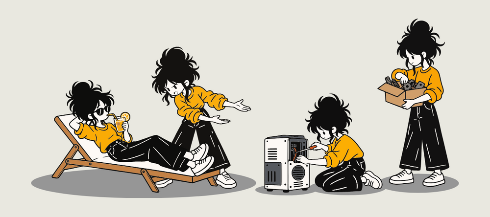
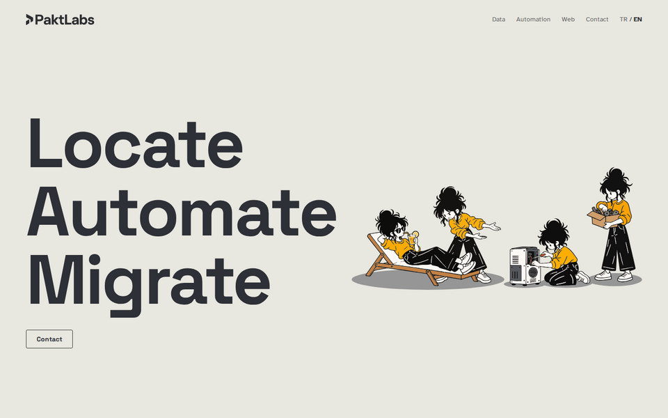
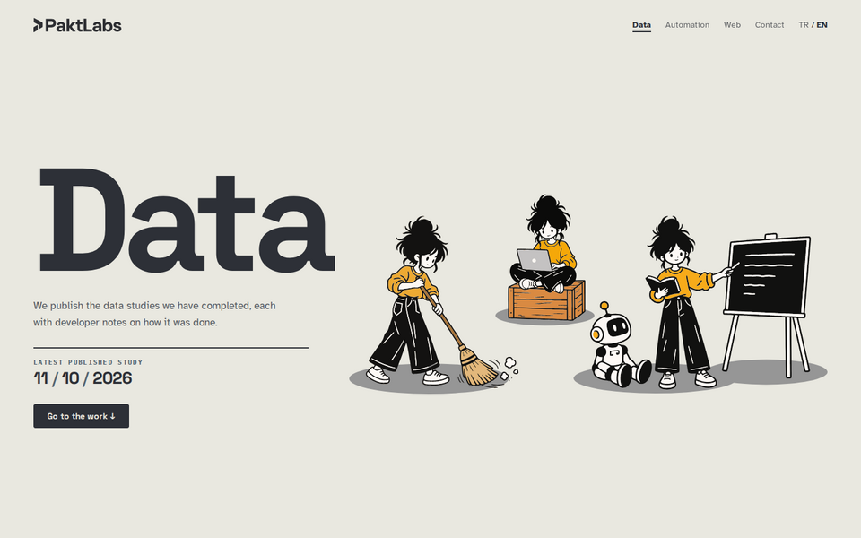
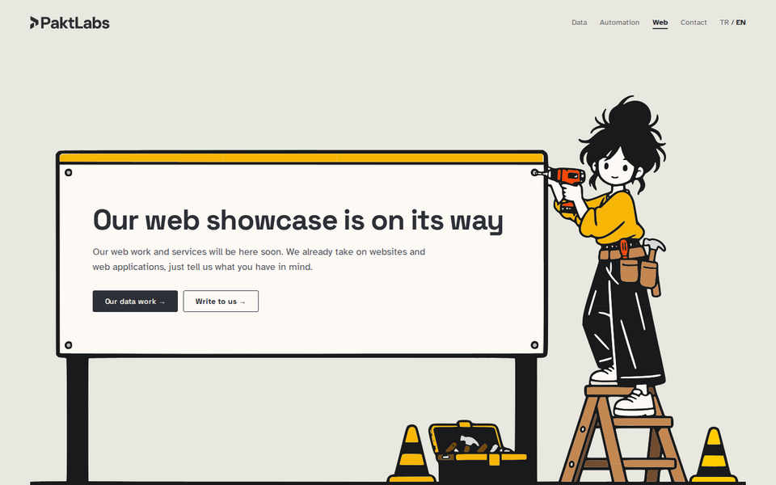
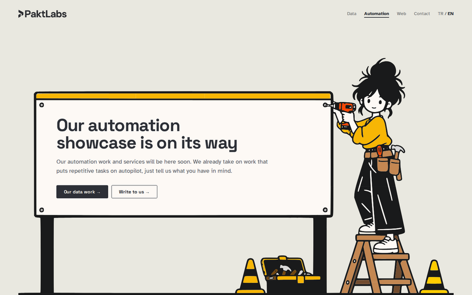

<div align="center">

<picture>
  <source media="(prefers-color-scheme: dark)" srcset="docs/readme/logo-dark.svg">
  
</picture>

<p><strong>Source of the PaktLabs studio sites.</strong><br>
A landing page and one site per discipline, built with React, Vite and TypeScript, with a small FastAPI contact service.</p>

<p>
<a href="https://paktlabs.com">paktlabs.com</a> ·
<a href="https://data.paktlabs.com">data.paktlabs.com</a> ·
<a href="https://web.paktlabs.com">web.paktlabs.com</a> ·
<a href="https://automation.paktlabs.com">automation.paktlabs.com</a>
</p>

<p><a href="https://github.com/ayanburak/paktlabs.com/actions/workflows/ci.yml"></a></p>

<p><strong>English</strong> · <a href="README.tr.md">Türkçe</a></p>

</div>

<p align="center"></p>

## About

PaktLabs is an independent software studio working on data, automation and web projects. This repository holds the studio's public sites: the landing page at paktlabs.com, which is not tied to any single field, and a separate site for each discipline under its own subdomain. The data site is live and publishes the studio's case studies with their code and data files. The web and automation sites show a placeholder page until their own content is ready.

The sites live in one repository because they are parts of the same studio. A visitor moving from one site to another meets the same header, footer, colours and language choice, and all of that is written once.

## Sites

<table>
<tr>
<td width="50%" valign="top">
<a href="https://paktlabs.com"></a>
<p><strong>Landing</strong> · <a href="https://paktlabs.com">paktlabs.com</a><br>
The studio's front page, a step by step contact page and the team profiles.</p>
</td>
<td width="50%" valign="top">
<a href="https://data.paktlabs.com"></a>
<p><strong>Data</strong> · <a href="https://data.paktlabs.com">data.paktlabs.com</a><br>
Case studies with their code and data samples, and a page for each data service.</p>
</td>
</tr>
<tr>
<td width="50%" valign="top">
<a href="https://web.paktlabs.com"></a>
<p><strong>Web</strong> · <a href="https://web.paktlabs.com">web.paktlabs.com</a><br>
Placeholder page while the web showcase is being prepared.</p>
</td>
<td width="50%" valign="top">
<a href="https://automation.paktlabs.com"></a>
<p><strong>Automation</strong> · <a href="https://automation.paktlabs.com">automation.paktlabs.com</a><br>
Placeholder page while the automation showcase is being prepared.</p>
</td>
</tr>
</table>

## Structure

```
apps/
  landing/             paktlabs.com
  data/                data.paktlabs.com
  web/                 web.paktlabs.com
  automation/          automation.paktlabs.com
packages/
  brand/               shared header, footer, page frame, colours, texts and content
  config/              shared TypeScript, Vite and Playwright setup
services/
  contact-api/         FastAPI service behind the contact form
scripts/               packaging, release and rollback scripts
```

The repository is an npm workspaces monorepo with a single lock file. Everything the sites share sits in `packages/brand`, so a change to a colour or a menu label reaches every site at once. `packages/config` keeps the build and test setup in one place, and each site only calls it with its own port. Inside a site, the parts of a section stay in that section's folder, and only the parts used by more than one section move to `src/components`.

Working portfolio applications do not live here. They have their own repositories and run as their own services, so a release of one application never depends on a release of the showcase. The contact service is the one exception: the form and the service speak the same message format, so they change in the same commit.

## Technical choices

### Multi page builds instead of single page apps

The landing page is built as several pages, each with its own HTML file and its own small script. A single page app would make the server answer every unknown address with the home page and a 200 status, so a real 404 page would not exist. With separate files, every page has its title in the HTML before any script runs, unknown addresses get a true 404, and no page downloads another page's code. The data site is the exception: it uses React Router, because its study pages load their texts and files only when they are opened.

### Hand written CSS

All styles are written by hand, without a utility CSS framework. The studio's sites should have a look of their own that a framework could not reproduce. Shared colours and spacing are tokens in `packages/brand/styles/tokens.css`, and every component keeps its own styles in a CSS module next to it. Media queries use the classic `min-width` and `max-width` form, because older Safari versions silently drop a whole rule written with the newer range syntax.

### Two languages in two layers

The sites are in Turkish and English. Texts that are the same on every site, such as menu labels, live in the brand package, and each site keeps only the texts of its own pages. TypeScript checks that both languages have the same keys, so a missing translation breaks the build. The language choice is stored in a cookie shared by all subdomains, so it stays the same when a visitor moves between sites.

### A contact service that does not trust the form

The service validates every field again on the server, rejects unknown fields and refuses line breaks in anything that ends up in an email header. A hidden honeypot field catches simple bots without telling them they were caught. nginx limits how often one address and all visitors together can send, and the service itself stops accepting messages after fifty in a day, so a slow bot spread over many addresses cannot use up the mail quota. A contract test reads the form's options and length limits from the landing source and compares them with the service, so the two cannot drift apart silently. The visitor's IP address is never stored.

<details>
<summary><strong>Development</strong></summary>

<br>

Node.js 24 is used. Dependencies are installed once at the root, and site commands run inside the site's folder.

```bash
npm ci
npm run lint
npm run typecheck
cd apps/landing
npm run dev          # http://localhost:5173
npm run build
```

The sites run on ports 5173 to 5176, so all four can be open at once. The contact service runs on port 8001 with Python 3.10, the version on the server, and the landing dev server forwards `/api` requests to it. Running it locally is described in `services/contact-api/README.md`.

</details>

<details>
<summary><strong>Tests</strong></summary>

<br>

Every site is tested with Playwright against its production build. Behaviour tests cover language switching, links, accessibility, responsive layout and the contact flow. Visual tests compare full page screenshots with approved references and run only locally, because the references depend on local font rendering. The contact service has its own pytest suite.

```bash
cd apps/landing
npx playwright install chromium
npm test
npm run test:visual
```

GitHub Actions runs lint, type checks, the behaviour tests of every site and the service tests on every push and pull request. Test conditions and tolerances are described in each site's `tests/README.md`.

</details>

<details>
<summary><strong>Releases</strong></summary>

<br>

Pushing to GitHub does not change the live sites. A release is built from a committed revision with `git archive`, so uncommitted changes can never reach the server. The package carries a checksum for every file and pre-compressed copies for nginx. On the server it is unpacked into its own release folder, checked, and made live by renaming a single symlink, so visitors never see a half copied site. Older releases stay in place and a rollback only points the symlink back.

```bash
scripts/build-release.sh landing
scripts/deploy-release.sh landing release/paktlabs-<time>-<commit>.tar.gz
scripts/rollback-release.sh landing <release>
```

The contact service uses the same scripts under the name `api`. Its release installs its own Python environment and returns to the previous release by itself if the new one does not answer its health check.

</details>

## Browser support

The sites are checked in Chromium on Linux. Firefox, Safari and real phones and tablets have not been tested yet.

## License

All rights reserved. The code is public so that it can be read and reviewed, but it may not be copied or reused without permission. Details are in [LICENSE](LICENSE).
