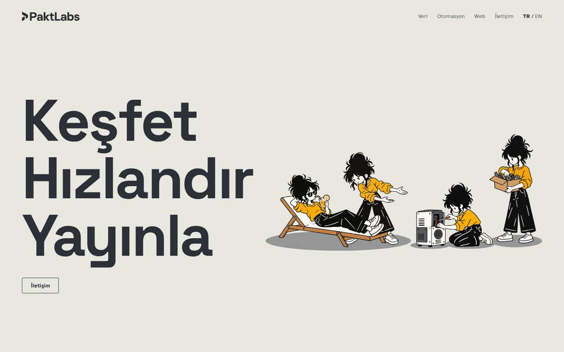
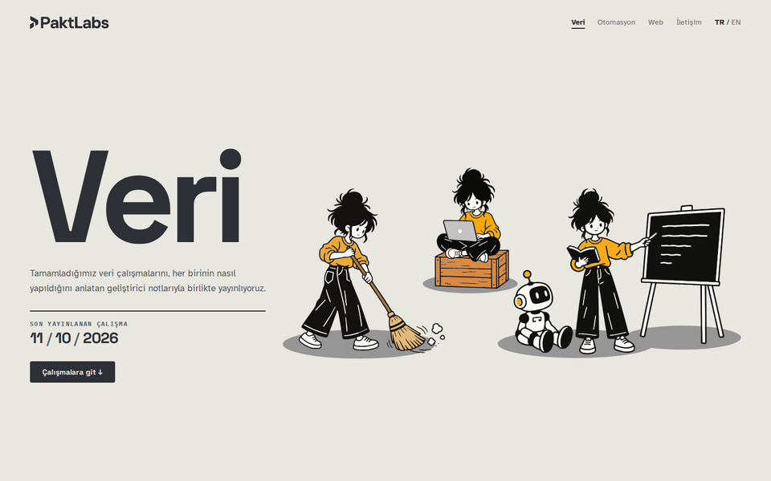
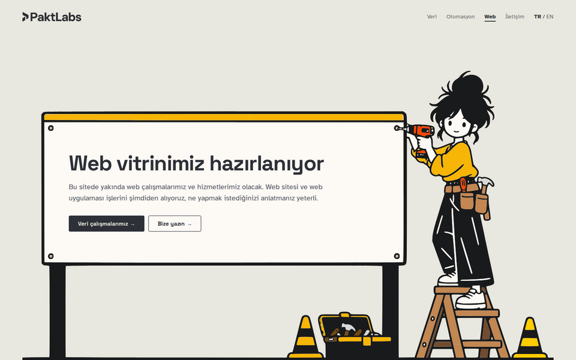
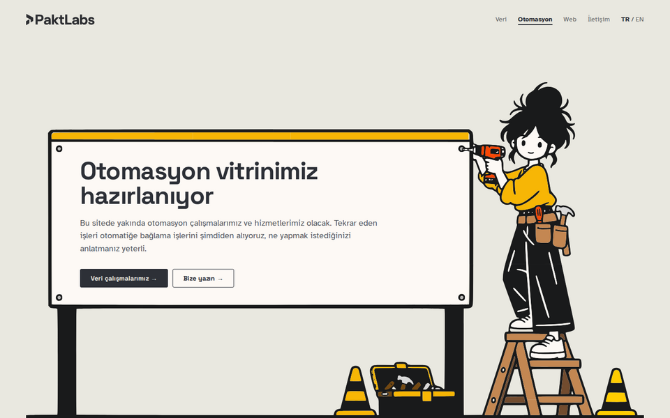

<div align="center">

<picture>
  <source media="(prefers-color-scheme: dark)" srcset="docs/readme/logo-dark.svg">
  
</picture>

<p><strong>PaktLabs stüdyo sitelerinin kaynağı.</strong><br>
Bir landing sayfası ve her disiplin için ayrı bir site. React, Vite ve TypeScript ile yazıldı, yanında küçük bir FastAPI iletişim servisi var.</p>

<p>
<a href="https://paktlabs.com">paktlabs.com</a> ·
<a href="https://data.paktlabs.com">data.paktlabs.com</a> ·
<a href="https://web.paktlabs.com">web.paktlabs.com</a> ·
<a href="https://automation.paktlabs.com">automation.paktlabs.com</a>
</p>

<p><a href="https://github.com/ayanburak/paktlabs.com/actions/workflows/ci.yml"></a></p>

<p><a href="README.md">English</a> · <strong>Türkçe</strong></p>

</div>

<p align="center"></p>

## Hakkında

PaktLabs veri, otomasyon ve web alanlarında çalışan bağımsız bir yazılım stüdyosudur. Bu repo stüdyonun herkese açık sitelerini tutar: tek bir alana bağlı olmayan paktlabs.com landing sayfası ve her disiplin için kendi subdomain'inde ayrı bir site. Veri sitesi yayındadır ve stüdyonun çalışmalarını kod ve veri dosyalarıyla birlikte yayınlar. Web ve otomasyon siteleri kendi içerikleri hazırlanana kadar bir yer tutucu sayfa gösterir.

Siteler tek repoda durur, çünkü aynı stüdyonun parçalarıdır. Bir siteden ötekine geçen ziyaretçi aynı üst barla, alt bilgiyle, renklerle ve dil seçimiyle karşılaşır, bunların hepsi bir kez yazılır.

## Siteler

<table>
<tr>
<td width="50%" valign="top">
<a href="https://paktlabs.com"></a>
<p><strong>Landing</strong> · <a href="https://paktlabs.com">paktlabs.com</a><br>
Stüdyonun ön yüzü, adım adım ilerleyen iletişim sayfası ve ekip profilleri.</p>
</td>
<td width="50%" valign="top">
<a href="https://data.paktlabs.com"></a>
<p><strong>Veri</strong> · <a href="https://data.paktlabs.com">data.paktlabs.com</a><br>
Kod ve veri örnekleriyle yayınlanan çalışmalar ve her veri hizmeti için bir sayfa.</p>
</td>
</tr>
<tr>
<td width="50%" valign="top">
<a href="https://web.paktlabs.com"></a>
<p><strong>Web</strong> · <a href="https://web.paktlabs.com">web.paktlabs.com</a><br>
Web vitrini hazırlanırken duran yer tutucu sayfa.</p>
</td>
<td width="50%" valign="top">
<a href="https://automation.paktlabs.com"></a>
<p><strong>Otomasyon</strong> · <a href="https://automation.paktlabs.com">automation.paktlabs.com</a><br>
Otomasyon vitrini hazırlanırken duran yer tutucu sayfa.</p>
</td>
</tr>
</table>

## Yapı

```
apps/
  landing/             paktlabs.com
  data/                data.paktlabs.com
  web/                 web.paktlabs.com
  automation/          automation.paktlabs.com
packages/
  brand/               ortak üst bar, alt bilgi, sayfa çerçevesi, renkler, metinler ve içerik
  config/              ortak TypeScript, Vite ve Playwright ayarı
services/
  contact-api/         iletişim formunun arkasındaki FastAPI servisi
scripts/               paketleme, yayın ve geri dönüş script'leri
```

Repo, tek bir kilit dosyasıyla kurulan bir npm workspaces monoreposudur. Sitelerin paylaştığı her şey `packages/brand`'de durur, böylece bir rengin ya da bir menü etiketinin değişmesi bütün sitelere aynı anda ulaşır. `packages/config` derleme ve test ayarını tek yerde tutar, her site onu yalnızca kendi portuyla çağırır. Bir sitenin içinde bir bölümün parçaları o bölümün klasöründe kalır, yalnızca birden fazla bölümün kullandığı parçalar `src/components`'a taşınır.

Çalışan portföy uygulamaları bu repoda durmaz. Kendi repolarında yazılır ve kendi servisleri olarak çalışır, böylece bir uygulamanın yayını vitrinin yayınına hiçbir zaman bağlanmaz. Tek istisna iletişim servisidir: form ile servis aynı mesaj biçimini konuşur, bu yüzden aynı commit'te değişirler.

## Teknik tercihler

### Tek sayfalık uygulama yerine çok sayfalı derleme

Landing sayfası her biri kendi HTML dosyası ve kendi küçük script'iyle gelen birkaç sayfa olarak derlenir. Tek sayfalık bir uygulamada sunucu bilinmeyen her adrese ana sayfayla ve 200 koduyla cevap verirdi, gerçek bir bulunamadı sayfası olmazdı. Ayrı dosyalarla her sayfanın başlığı script çalışmadan önce HTML'de yazılıdır, bilinmeyen adresler gerçek bir 404 alır ve hiçbir sayfa başka bir sayfanın kodunu indirmez. Veri sitesi bunun istisnasıdır: React Router kullanır, çünkü çalışma sayfaları metinlerini ve dosyalarını yalnızca açıldıklarında yükler.

### Elle yazılmış CSS

Bütün stiller elle yazılır, utility CSS framework'ü kullanılmaz. Stüdyonun sitelerinin bir framework'ün yeniden üretemeyeceği kendine ait bir görünümü olmalı. Ortak renkler ve boşluklar `packages/brand/styles/tokens.css`'te token olarak durur, her bileşen kendi stillerini yanındaki CSS modülünde tutar. Medya sorguları klasik `min-width` ve `max-width` biçiminde yazılır, çünkü eski Safari sürümleri yeni range sözdizimiyle yazılan bir kuralın tamamını sessizce yok sayar.

### İki katmanda iki dil

Siteler Türkçe ve İngilizcedir. Menü etiketleri gibi her sitede aynı kalan metinler brand paketinde durur, her site yalnızca kendi sayfalarının metinlerini taşır. TypeScript iki dilin aynı anahtarlara sahip olduğunu denetler, eksik bir çeviri derlemeyi kırar. Dil seçimi bütün subdomain'lerin paylaştığı bir çereze yazılır, böylece ziyaretçi siteler arasında geçerken dil değişmez.

### Forma güvenmeyen bir iletişim servisi

Servis her alanı sunucuda yeniden denetler, tanımlanmamış alanları reddeder ve e-posta başlığına giren hiçbir değerde satır sonuna izin vermez. Görünmeyen bir tuzak alan basit botları yakalandıklarını belli etmeden ayıklar. nginx tek bir adresin ve bütün ziyaretçilerin birlikte ne sıklıkta gönderebileceğini sınırlar, servisin kendisi de bir günde elli mesajdan sonra yeni mesaj kabul etmez. Böylece birçok adrese yayılmış yavaş bir bot bile posta kotasını tüketemez. Bir sözleşme testi formun seçeneklerini ve uzunluk sınırlarını landing'in kaynağından okuyup servisle karşılaştırır, ikisi sessizce birbirinden ayrışamaz. Ziyaretçinin IP adresi hiçbir zaman saklanmaz.

<details>
<summary><strong>Geliştirme</strong></summary>

<br>

Node.js 24 kullanılır. Bağımlılıklar kökte bir kez kurulur, site komutları sitenin kendi klasöründe çalıştırılır.

```bash
npm ci
npm run lint
npm run typecheck
cd apps/landing
npm run dev          # http://localhost:5173
npm run build
```

Siteler 5173 ile 5176 arasındaki portlarda açılır, dördü aynı anda açık kalabilir. İletişim servisi 8001 portunda, sunucudaki sürüm olan Python 3.10 ile çalışır, landing'in geliştirme sunucusu `/api` isteklerini ona aktarır. Servisin yerelde nasıl çalıştırılacağı `services/contact-api/README.md`'de anlatılır.

</details>

<details>
<summary><strong>Testler</strong></summary>

<br>

Her site Playwright ile kendi üretim derlemesine karşı test edilir. Davranış testleri dil değiştirmeyi, bağlantıları, erişilebilirliği, responsive yerleşimi ve iletişim akışını kapsar. Görsel testler tam sayfa ekran görüntülerini onaylı referanslarla karşılaştırır ve yalnızca yerelde çalışır, çünkü referanslar yerel font çizimine bağlıdır. İletişim servisinin kendi pytest testleri vardır.

```bash
cd apps/landing
npx playwright install chromium
npm test
npm run test:visual
```

GitHub Actions her push ve pull request'te lint'i, tip kontrolünü, bütün sitelerin davranış testlerini ve servisin testlerini çalıştırır. Test koşulları ve toleranslar her sitenin `tests/README.md` dosyasında anlatılır.

</details>

<details>
<summary><strong>Yayın</strong></summary>

<br>

GitHub'a push yapmak canlı siteleri değiştirmez. Yayın paketi commit'lenmiş bir sürümden `git archive` ile üretilir, böylece commit'lenmemiş bir değişiklik sunucuya hiçbir zaman ulaşamaz. Paket her dosyanın özetini ve nginx için önceden sıkıştırılmış kopyaları taşır. Sunucuda kendi sürüm klasörüne açılır, denetlenir ve tek bir symlink'in yeniden adlandırılmasıyla canlıya alınır, böylece ziyaretçi hiçbir anda yarım kopyalanmış bir site görmez. Eski sürümler yerinde kalır, geri dönüş yalnızca symlink'i eski sürüme çevirir.

```bash
scripts/build-release.sh landing
scripts/deploy-release.sh landing release/paktlabs-<zaman>-<commit>.tar.gz
scripts/rollback-release.sh landing <sürüm>
```

İletişim servisi aynı script'leri `api` adıyla kullanır. Yayını kendi Python ortamını kurar, yeni sürüm sağlık kontrolüne cevap vermezse önceki sürüme kendiliğinden döner.

</details>

## Tarayıcı desteği

Siteler Linux üzerinde Chromium ile denetlenir. Firefox, Safari ve gerçek telefon ve tabletlerde henüz test yapılmadı.

## Lisans

Tüm hakları saklıdır. Kod okunabilsin ve incelenebilsin diye herkese açıktır, ama izin alınmadan kopyalanamaz ve yeniden kullanılamaz. Ayrıntılar [LICENSE](LICENSE) dosyasında.
